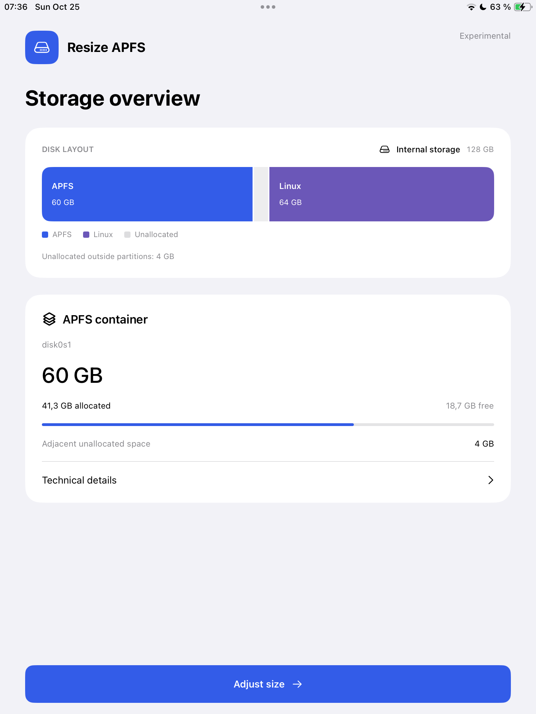
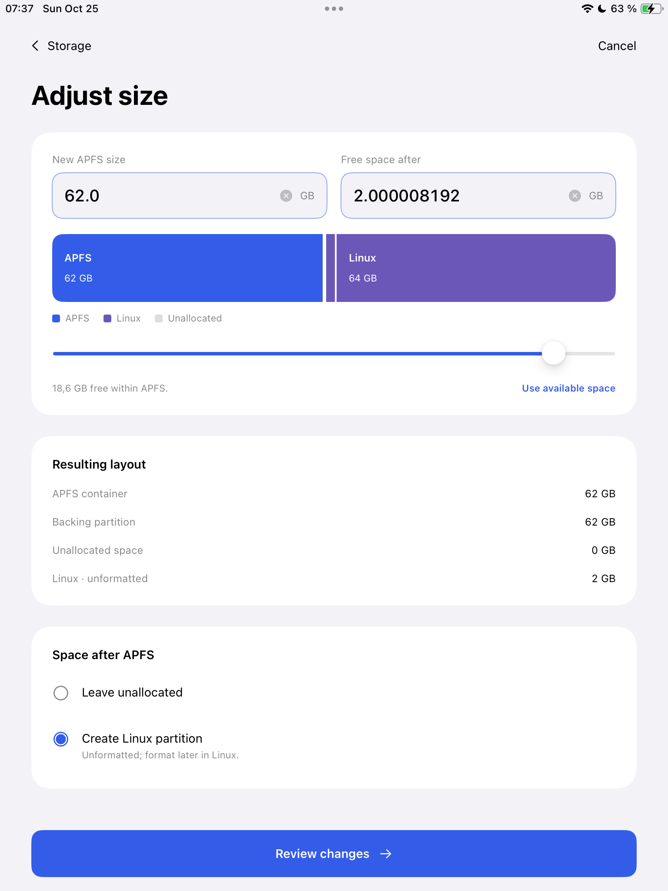

# Resize APFS

Shrink your iPhone or iPad's iOS storage to make room for Linux, and grow it back.

**Back up your device first.**

  
  

## Use

You need a Mac or a Linux PC (Python 3.9+) and a USB cable. Download the
[latest release](https://github.com/OrchardLinux/resize-apfs/releases), unzip it and
open Terminal in the `ResizeAPFS-v…` folder. Then pick the method for your device:

| Method | Devices | iOS/iPadOS |
| --- | --- | --- |
| **DFU** (palera1n) | A8 to A11 | 15 or later |
| **DFU** (checkra1n) | A7 to A11 | 12 to 14 |
| **Dopamine**, no DFU | A8 to A13 | 15.0 to 18.7.1, 26.0 to 26.0.1 |
| | A14 and later | 15.0 to 17.3.1 |

### Via DFU (checkra1n / palera1n)

1. Run `./resize-apfs boot` and answer which iOS version the device runs.
2. Put the device in DFU mode when asked.
3. Unlock the device after iOS starts. Resize APFS opens by itself.
4. On iOS 12 to 14: when you are done, type `done` in the terminal to remove the app.

If the boot fails, enter DFU and run it again; it often takes a few tries. Stuck at
the Apple logo: unplug the cable briefly. Close browsers that use WebUSB first.

### Via Dopamine

1. Turn on Developer Mode: **Settings > Privacy & Security > Developer Mode**. The
   device restarts; confirm **Turn On**.
2. Connect the device, unlock it and trust the computer.
3. Run `./resize-apfs boot --dopamine` and press Enter at the Developer Mode question.
4. Sign in with your Apple ID when asked; it goes only to Apple. On a Mac signed in
   to Xcode, that account is used.
5. Trust your Apple ID on the device: **Settings > General > VPN & Device Management**.
6. Open Dopamine and tap **Jailbreak**. When it asks for a package manager, select
   **Sileo**, then set a password.
7. Enter that password in the terminal. Resize APFS opens by itself.
8. When you are done, type `done` in the terminal to remove the app.

After a restart, tap **Jailbreak** in Dopamine again before the next session.

### In the app

Choose **Adjust size**, enter the new size, confirm, and wait for **Completed and
verified**. Large shrinks run in steps; you can close the app, but don't restart the
device until it is done.

## Tested devices

| Device | iOS/iPadOS | Method |
| --- | --- | --- |
| iPhone XR | 18.3.2 | Dopamine |
| iPhone X (d221) | 16.7 | DFU (palera1n), Linux host |
| iPad (6th generation) | 17.7.11 | DFU (palera1n) |
| iPad mini 4 (J96) | 15.8.3 | DFU (palera1n), Linux host |
| iPad Air (J71) | 12.5.3 | DFU (checkra1n) |
| iPod touch 6 (N102) | 12.4 | DFU (checkra1n) |

## Development

Open `ResizeAPFS.xcodeproj`, or run `./scripts/run-simulator.sh`. Host tests:
`swift test -j 2`. Build a release ZIP with `./scripts/build-device.sh`,
`./scripts/build-device-ios12.sh` and `./scripts/package-release.sh preview`.
Details: [Device/README.md](Device/README.md).

## License

[MIT](LICENSE). See [third-party notices](THIRD_PARTY_NOTICES.md).
Built on prior work from [Hoolock Linux](https://github.com/HoolockLinux/docs)
and [palera1n](https://github.com/palera1n), including jbinit.
