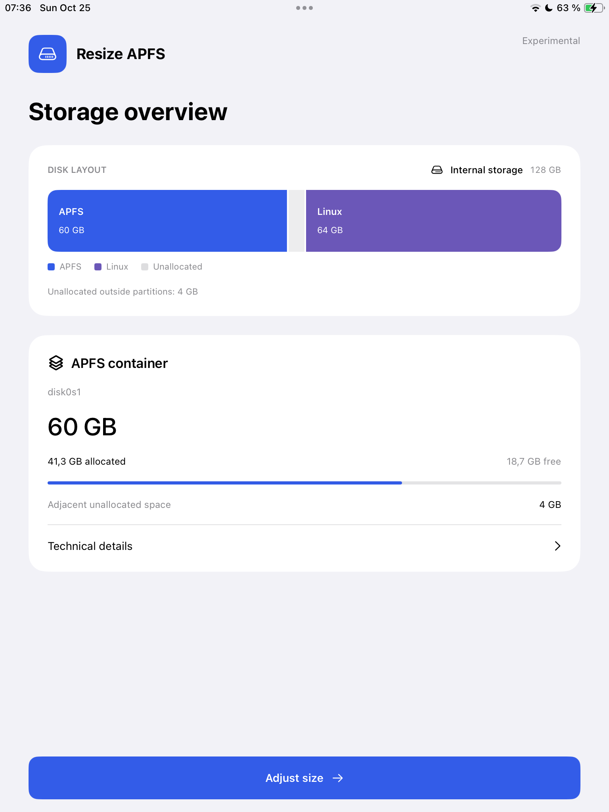
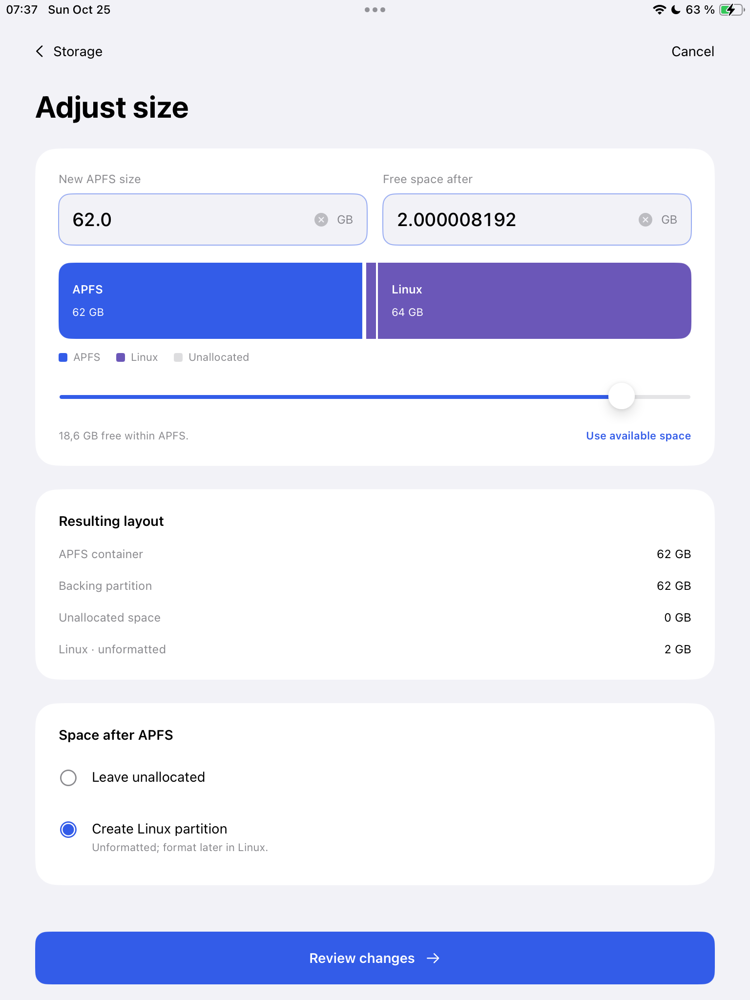

# Resize APFS

Resize your iPhone or iPad’s APFS storage to make room for Linux. A native app
handles APFS resizing, partition-table updates and readback verification. You can
leave the released space unallocated or create an unformatted Linux partition.

**Experimental. Back up your device first. Storage changes can cause data loss.**

<p>
  
  
</p>

## Requirements

- A palera1n-compatible iPhone or iPad running iOS/iPadOS 16 or later.
- Linux (x86_64 or ARM64, glibc 2.35+) or macOS (Intel or Apple Silicon).
- Python 3.9 or later and a USB connection to the device.
- [palera1n](https://palera.in/) 2.4 or later, installed separately and available in
  your PATH. Compatible overlays are checked by structure, not a version/hash whitelist.

Hardware-tested on iPad (6th generation, Wi-Fi / J71b), iPadOS 17.7.11. The CI-built
release ZIP, prepared in Linux and booted through macOS palera1n, successfully
completed boot, app launch, storage inspection and a 64 GB → 60 GB APFS shrink.
Growth, Linux partition creation, other device/OS combinations and native Linux
USB/DFU remain unverified.

## Use

> [!IMPORTANT]
> **Boot tips**
> - **Before DFU:** close browsers that may use WebUSB. In Chrome, you can disable
>   USB access at `chrome://settings/content/usbDevices`.
> - **Stuck at the Apple logo after palera1n starts?** Briefly disconnect the cable
>   from the device, then reconnect it.

1. Back up your device.
2. Download the release ZIP from [GitHub Releases](https://github.com/OrchardLinux/resize-apfs/releases/latest) and unzip it.
3. Open Terminal in the extracted folder and run:

   ```sh
   ./resize-apfs boot
   ```

   The launcher checks prerequisites, prepares the custom overlay locally using
   your palera1n installation, and asks before starting the boot process. Follow
   the palera1n prompts to enter DFU mode.

4. Wait for iOS/iPadOS to finish starting normally, then unlock your device.
5. Wait for the Resize APFS icon to appear on the Home Screen. **This can take
   about a minute.** Once the icon appears, open **Resize APFS**.
6. Choose **Adjust size**, enter your target, then review and confirm the changes.
7. Wait for **Completed and verified** before restarting the device.

Booting loads the utility; it does not automatically resize anything. On Linux,
only starting palera1n may prompt for sudo; image preparation does not require root.

## While resizing

Closing the app does not stop the operation. Reopen it to check the same operation.
Do not restart the device or run another storage tool while it is working.

Progress shows observed status, not an estimated percentage. **Status unavailable**
means confirmation is missing—not that the resize failed. Do not retry or reboot
solely because status is unavailable. If an operation stops with an error, inspect
the reported layout before attempting another change.

## How it works

The privileged helper calls Apple’s APFS framework already installed on the
device. It coordinates APFS and GPT changes and verifies the resulting layout.
Creating a Linux partition does not format it or install Linux.

palera1n is an external dependency, not included in the release. No framework or
firmware is bundled.

## Development

Open `ResizeAPFS.xcodeproj`, or run an existing simulator with:

```sh
./scripts/run-simulator.sh
```

Simulator builds use synthetic storage. Run host tests with `swift test -j 2`.
See [Device/README.md](Device/README.md) for backend, overlay and build details.

## Release builds

The release workflow runs only for `v*` tags or manual requests. One macOS job
builds the app; small Linux jobs build host tools and assemble the release. Tagged builds create draft releases. Manual builds in private repositories
also retain the ZIP and checksum in a draft release; workflow artifacts expire
after two days, but release assets do not use that expiry.

Public builds include GitHub provenance attestations and a Sigstore bundle.
Private builds skip attestation. To verify a public download with the GitHub CLI:

```sh
gh attestation verify ResizeAPFS-v0.1.0.zip --repo OrchardLinux/resize-apfs
```

To build and package locally:

```sh
./scripts/build-device.sh
./scripts/package-release.sh preview
```

For complete Linux support, also build `scripts/build-linux-tools.sh` on Linux
x86_64 and ARM64 and collect both `out/host-tools/linux-*` directories before
packaging with `--require-linux-tools`. Linux tools need a C compiler and zlib
headers to build; release users receive the compiled tools and their source.

Output: `out/releases/ResizeAPFS-preview.zip`. The ZIP includes only our
payload and assembly scripts, not palera1n or an assembled overlay.

## License

[MIT](LICENSE). See [third-party notices](THIRD_PARTY_NOTICES.md) for upstream credits and licenses.

## Credits

Built on prior work from [Hoolock Linux](https://github.com/HoolockLinux/docs)
and [palera1n](https://github.com/palera1n), including jbinit.
